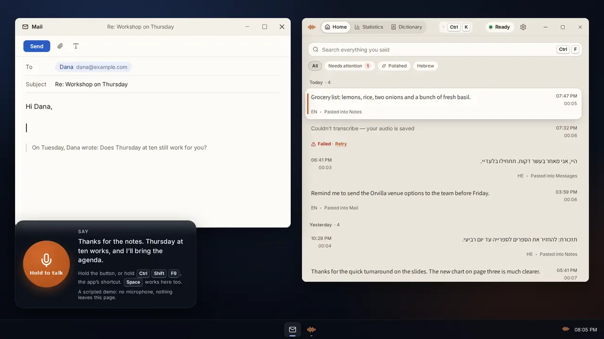
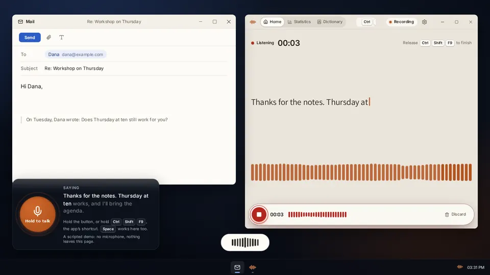
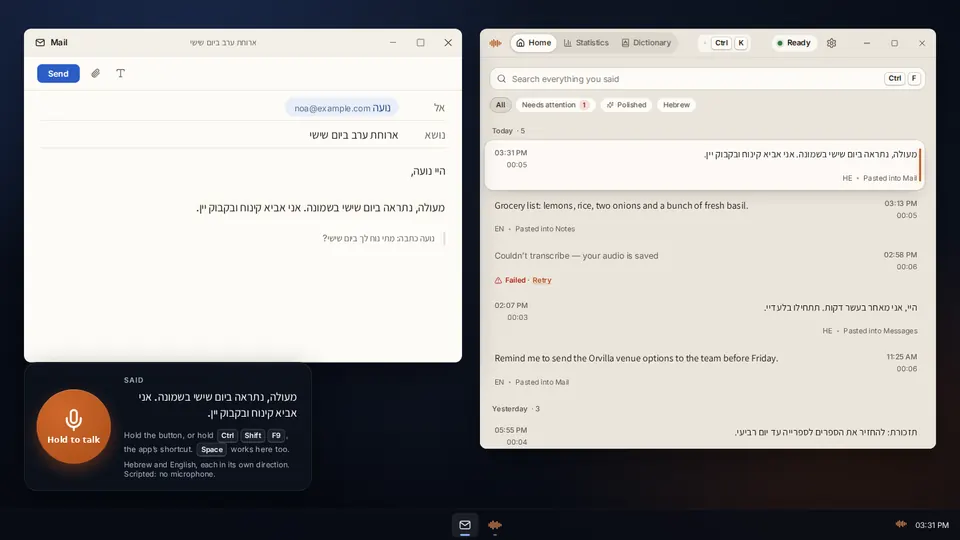
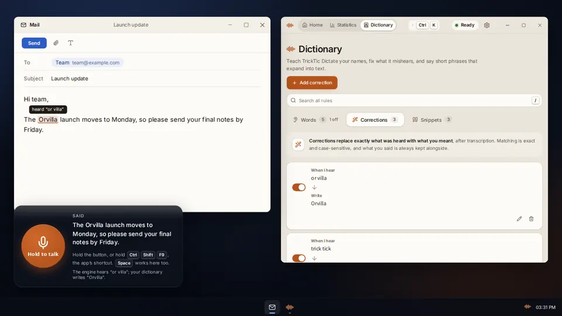
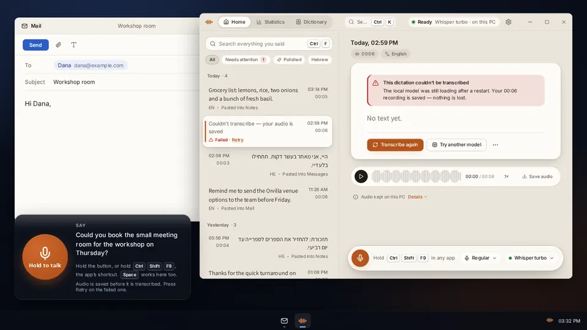
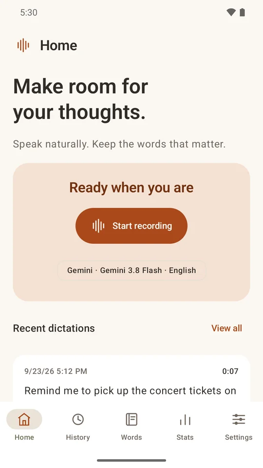
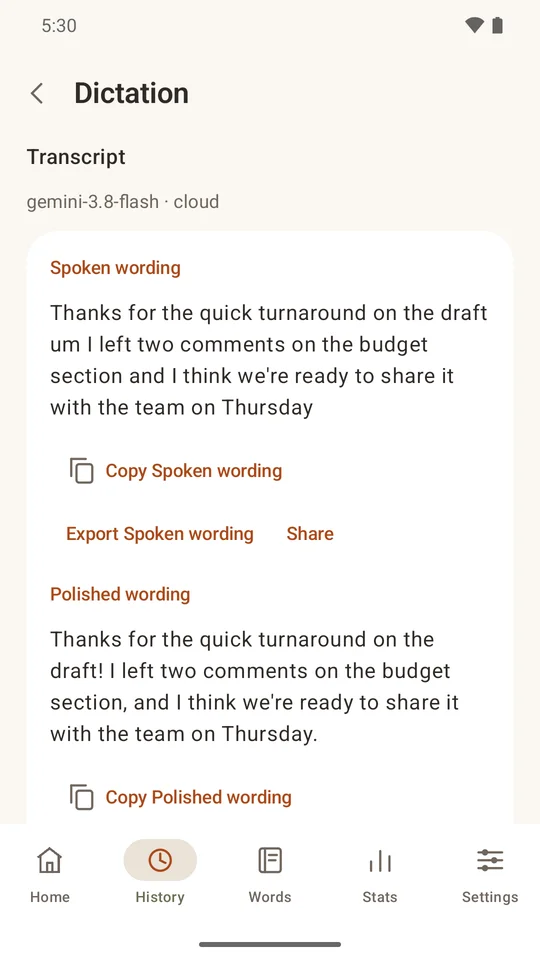
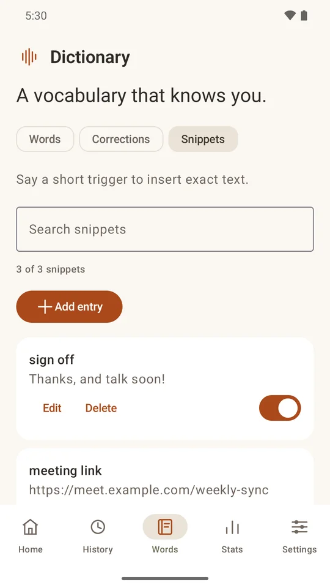
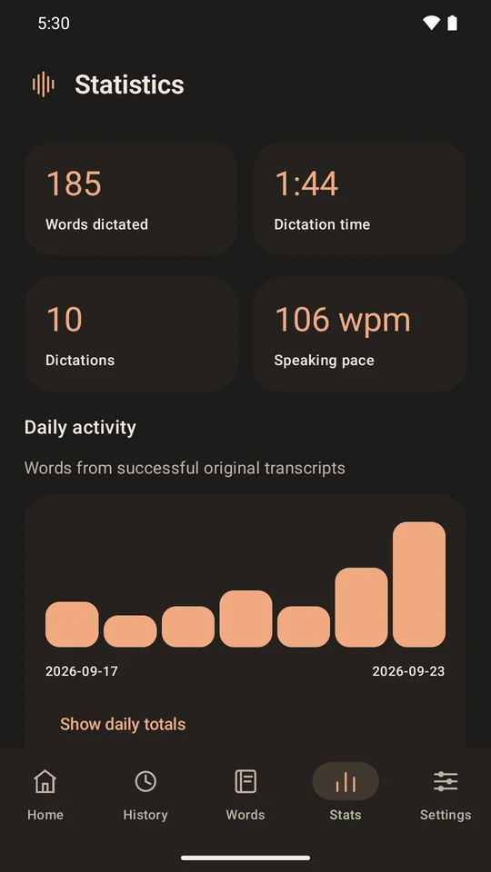

<p align="center">
  
</p>

<h1 align="center">TrickTic Dictate</h1>

<p align="center">
  <b>Speak anywhere. It's typed.</b><br>
  Free, open-source dictation for Windows, Mac and Android, in English, Hebrew or both.
</p>

<p align="center">
  <a href="https://www.youtube.com/@TrickTicAI"></a>
  <a href="https://tricktic.com/dictate/"></a>
  <a href="https://play.google.com/store/apps/details?id=com.tricktic.dictate"></a>
</p>

<p align="center">
  ▶️ <b><a href="https://www.youtube.com/@TrickTicAI">Watch on YouTube</a></b>: coding agents, demos, and how TrickTic apps like this one get built.<br>
  <sub><a href="LICENSE">Apache-2.0</a> · No account needed · No tracking · <a href="https://tricktic.com">tricktic.com</a></sub>
</p>

<p align="center">
  <a href="https://tricktic.com/dictate/#demo">
    
  </a>
  <br>
  <sub>The real app UI running a scripted demo. <a href="https://tricktic.com/dictate/#demo">Try it yourself in the browser</a>, no install or microphone needed.</sub>
</p>

---

Hold a shortcut in any app, say what you want to write, and let go. Your words
land at the cursor, cleaned up if you want them to be.

**Made by people, for people.** Most dictation tools are a subscription in
front of somebody else's server. TrickTic Dictate is free and open source. It
runs on your machine, talks to the speech service *you* pick with *your* key,
and keeps your recordings on your own disk. Privacy here is a setting you can
actually turn on, not a paragraph in a policy, and the code is right here to
prove it.

## Private for real

- **Run it entirely on your own computer.** On Windows, speech recognition and
  polishing can both run locally with no internet at all. On Mac and Android,
  speech runs on the device, and polishing is yours to switch off or point at a
  cloud model.
- **No middleman.** When you do use the cloud, the app calls the provider
  directly with your own API key. There is no TrickTic server in between, and
  you pay the provider directly.
- **Keys stay locked up**, in Windows' protected storage, the macOS Keychain or
  the Android Keystore.
- **No analytics, no crash reporting, no account required.**

## Pick any model

| | Speech to text | Polishing |
|---|---|---|
| **On your device** | 36 Whisper models (whisper.cpp), including ivrit.ai models for Hebrew, plus NVIDIA Parakeet | Qwen3 4B or Mistral 7B via llama.cpp (Windows) |
| **Cloud, your key** | OpenAI, Gemini, Grok, Groq (Android) | OpenAI, Gemini, Grok, Groq (Android), and through OpenRouter Claude, Mistral, Mercury and more |

Add your own model IDs when a provider ships a new one, and set a backup model
for when your first choice is slow or down.

## Polish that's fast and careful

Super mode turns rambling speech into finished text: punctuation and
paragraphs, lists when you dictate one, no ums, and "no wait, make that
Thursday" applied for you. Choose light, polished or concise, and pick a fast
model to have it back almost as soon as you stop talking.

It also checks its own work. If the rewrite changes a number, drops a "not"
or switches the language, the polished version is rejected and you get exactly what you
said. Your original words are always one click away.

## Make it yours

Possibly the most customizable dictation app out there:

- **Shortcuts:** hold to talk or press to toggle, your own key combination, and a
  separate shortcut for each mode.
- **Typing:** paste where you stopped or where you started; never presses
  Enter or Send.
- **Clipboard:** restore what was on it after dictating, and keep dictation out
  of clipboard history.
- **Floating panel:** always, while dictating or never; top, bottom or wherever
  you drag it; your size and colors.
- **Sound:** start and stop sounds, and lower other audio while you talk.
- **Microphone:** pick the device, and skip Bluetooth headset mics.
- **Look:** 15 themes on desktop, 5 on Android.
- **Words:** a dictionary for names and terms, corrections for words it keeps
  getting wrong, and snippets that expand a spoken phrase into exact text.
- **Context:** let a mode see the app's title, your selected text or the
  clipboard, only if you turn it on.

Sign in with Google (optional) to sync your settings, dictionary and, if you
choose, your text history between your computers. Recordings and API keys are
never synced.

## English, Hebrew, or both

Hebrew is a first-class language, not a translation target. Each language gets
models chosen for it, Hebrew lays out right to left, and a sentence that mixes
the two keeps each word in the language you said it in. English, Hebrew and
mixed speech are tested as separate cases. Nothing is translated unless you ask.

## Nothing you say is lost

Every recording is saved before it is transcribed. A crash, a dropped
connection or a provider error leaves it in your history, ready to retry or to
run again with a different model.

## Screenshots

**Desktop (Windows and macOS)**

<table>
  <tr>
    <td width="50%"><br><sub>Hold the shortcut, speak, and the text lands at the cursor.</sub></td>
    <td width="50%"><br><sub>Hebrew dictation, laid out right to left.</sub></td>
  </tr>
  <tr>
    <td width="50%"><br><sub>Your dictionary fixes the words it mishears.</sub></td>
    <td width="50%"><br><sub>A failed transcription keeps its audio, ready to retry.</sub></td>
  </tr>
</table>

**Android**

<table>
  <tr>
    <td width="25%"><br><sub>Home</sub></td>
    <td width="25%"><br><sub>Spoken and polished</sub></td>
    <td width="25%"><br><sub>Snippets</sub></td>
    <td width="25%"><br><sub>Statistics</sub></td>
  </tr>
</table>

## By the numbers

<sub>As of version 0.40.2.</sub>

| | |
|---|---|
| First commit | 5 September 2026 |
| History | 1,037 commits across 291 merged pull requests |
| Code | ~144,000 lines: Rust 72k, TypeScript 25k, Kotlin 21k, Python 12k, JavaScript 9k, CSS 4k |
| Automated tests | 1,097: 559 Rust, 430 TypeScript/JavaScript, 82 Python, 26 Kotlin |
| Platforms | Windows, macOS (Apple silicon, signed and notarized), Android |
| Local speech models | 37 |
| Cloud providers | OpenAI, Gemini, Grok, Groq, OpenRouter |
| Themes | 15 |
| Analytics | none |

Built by one developer directing AI coding agents, each working in its own
branch and coordinated through a shared task board. This repository starts
from a clean snapshot; the development history stays private.

## How it's built

```
apps/desktop/tauri   Tauri v2 desktop host: tray/menu bar, global shortcut,
                     native capture, typing into the focused app, updates
apps/api             Rust/Axum core, embedded in the desktop app: recordings,
                     transcription jobs, providers, vocabulary, cleanup
apps/web             React/TypeScript UI, rendered inside the desktop app
apps/android         Standalone native Android app and keyboard input service
crates/, packages/   Shared audio code and API contracts
infra/firebase       Optional account sync: Firestore rules and cleanup service
```

The desktop app is one program: the Rust core runs in-process, and recordings,
transcripts and settings stay on your machine. Cloud keys live in the operating
system's credential store. The Android app talks to your chosen provider
directly and stores its key with Android Keystore. See
[privacy](docs/security/privacy.md), [permissions](docs/security/permissions.md)
and the [threat model](docs/security/threat-model.md) for the details.

## Build from source

Requirements: Node.js 22.9+, pnpm 9, a stable Rust toolchain, and the
[Tauri v2 prerequisites](https://v2.tauri.app/start/prerequisites/) for your OS.

```sh
pnpm install
pnpm dev              # UI and core in development mode
pnpm test             # Rust test suite
pnpm typecheck        # TypeScript
pnpm desktop:build    # desktop app for the current platform
```

The Android app builds with Gradle from `apps/android`; see
[its README](apps/android/README.md). Copy `.env.example` to `.env` for local
settings. It contains placeholders only, and real keys never belong in the
repository.

Builds you make yourself are unsigned. Before distributing your own build,
change the app identifiers, update endpoints and updater public key, which
point at the official TrickTic releases published at
[tricktic.com/dictate](https://tricktic.com/dictate/).

## Contributing and security

Bug reports and ideas are welcome in [Issues](https://github.com/TrickTicAI/tricktic-dictate/issues).
Pull requests are not accepted for now; open an issue instead. Please report
security problems privately as described in [SECURITY.md](SECURITY.md), not in
a public issue.

## Follow along

New TrickTic builds, coding-agent workflows and demos go up on YouTube first.

<p><a href="https://www.youtube.com/@TrickTicAI"></a></p>

## License

[Apache-2.0](LICENSE). Third-party components keep their own licenses; see [NOTICE](NOTICE).
